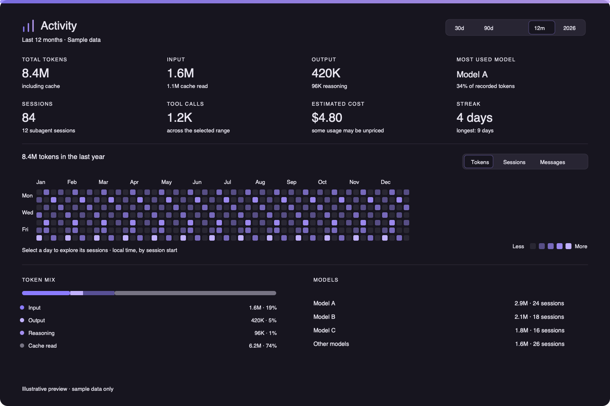

# hermes-activity

A read-only activity dashboard for Hermes Desktop. It adds a GitHub-style daily contribution grid, token totals and breakdowns, model and platform usage, tools, skills, activity hours, and notable sessions.



## Requirements

- Hermes Agent `>=0.21.5`
- Node.js `>=22.18` for native TypeScript provider collection, and npm to build the desktop UI
- Python is provided by Hermes for the native plugin backend; no additional Python dependencies are installed

## Install from Git

```sh
hermes plugins install https://github.com/hassan-kamel/hermes-activity
hermes plugins enable hermes-activity
```

Enable the Activity desktop surface in **Capabilities → Plugins**. On a local Hermes Desktop install, the page appears in the sidebar and in the `⌘K` palette as **Open Activity**. The desktop surface is opt-in when installed as part of a plugin package.

## Development

```sh
npm install
npm run build
npm run install:local
```

`install:local` copies the compiled `desktop/plugin.js` into `$HERMES_HOME/desktop-plugins/hermes-activity/`. Hermes Desktop watches this folder and hot-reloads the entry. Set `HERMES_HOME` when testing a non-default profile/home.

The UI source is `src/plugin.tsx`; it is TypeScript compiled to plain ESM by `tsc`, with no bundler and no runtime dependency beyond the Hermes Desktop SDK. Styling uses Hermes theme tokens and components so the page follows the active theme.

## Data and privacy

The Hermes tab reads the selected profile's `state.db` in SQLite read-only mode. Aggregates are computed locally on that profile. The desktop page uses Hermes' profile-routed `cli.exec` RPC; remote profiles run collection on their configured gateway.

The Providers tab is independent of the Quota plugin. Passive reads use Activity's own `activity_provider_history.json` cache under the selected `HERMES_HOME`. **Fetch provider data** reads the provider APIs using existing saved credentials, without signing in or changing credentials. CommandCode reports period totals only; Codex reports dated token buckets; OpenCode reports daily export totals; Ollama reports activity-period totals when a usable key is available. Missing metrics stay unknown, not zero. Summary-only totals never enter the annual heatmap. Combined figures represent reported account/workspace activity, not exclusively Hermes sessions, and can have partial source coverage.

No telemetry or credential values are stored in the usage cache or returned to the desktop. Provider caches store usage aggregates and a hashed scope identifier. See [THIRD_PARTY_NOTICES.md](THIRD_PARTY_NOTICES.md) for source-adapter attribution.

- `hermes activity provider-history --days 365 --desktop --json`
- `hermes activity provider-history --days 365 --desktop --json --refresh`

- `hermes activity summary --days 30 --json`
- `hermes activity summary --year 2026 --json`
- `hermes activity summary --days 365 --desktop --json` for the desktop page's compact breakdown payload
- `hermes activity day 2026-01-15 --json`
- `/activity 30` in a Hermes session

Daily buckets use the machine’s local time and assign a session to the date it started. Counts include subagent tokens; top-level and subagent session counts are shown separately. Cost is based on stored Hermes billing estimates/actuals and is not a provider-wide billing statement.

## Validation

```sh
npm run typecheck
npm run build
hermes plugins validate .
```

## License

MIT. See [LICENSE](LICENSE).
